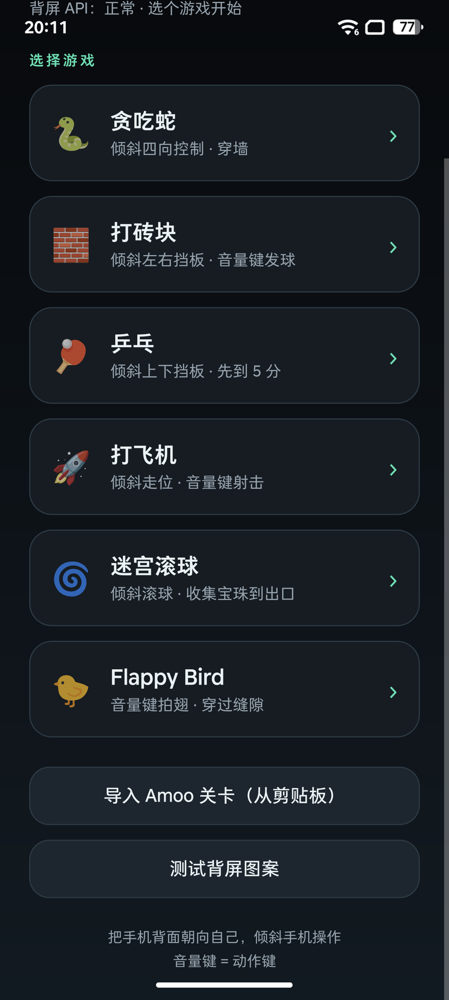
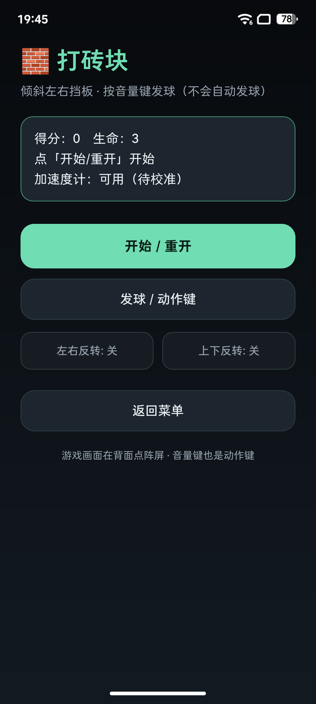
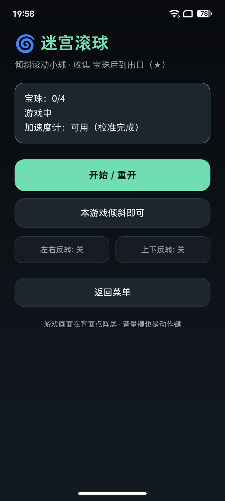
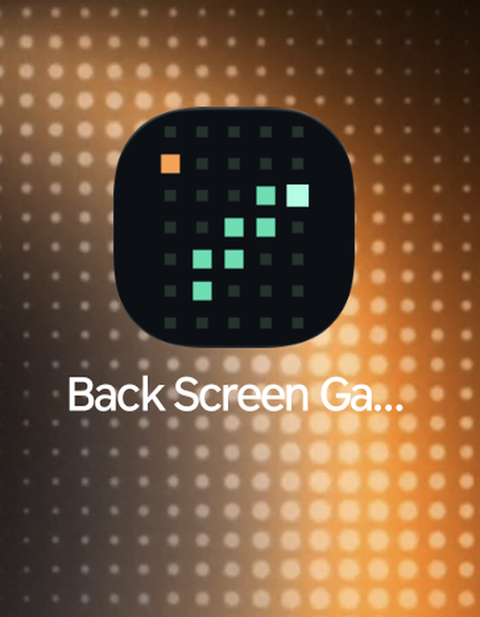

# Back Screen Game

[](https://github.com/xzl01/back-screen-game/actions/workflows/build.yml)

17×23 点阵小游戏合集，为 **STEPX Neo（StepOS / Android 16）** 的背面像素屏打造。

主菜单选游戏，手机背面朝向自己，倾斜手机/按音量键操作；游戏画面实时推送到背屏点阵（391 格亮度帧）。



## 游戏列表

| 游戏 | 玩法 | 操作 |
| --- | --- | --- |
| 🐍 贪吃蛇 | 穿墙（环形边界），吃食物变长加速 | 倾斜四向 |
| 🧱 打砖块 | 倾斜左右移动挡板，发球清砖；3 条命，不自动发球 | 倾斜左右 + 音量键发球 |
| 🏓 乒乓 | 倾斜上下移动左侧挡板 vs AI，先到 5 分 | 倾斜上下 |
| 🚀 打飞机 | 竖版射击，击落敌机得分；3 条命 | 倾斜左右 + 音量键射击 |
| 🌀 迷宫滚球 | 倾斜滚球收集全部宝珠后到出口 ★；多关卡 | 倾斜四向 |
| 🐤 Flappy Bird | 按音量键拍翅穿过管道缝隙；先拍翅才开始下落 | 音量键 |

### 迷宫多关卡 & Amoo 生成关卡

- 内置关卡按关号生成（种子固定可重玩）：第 1 关 4 颗宝珠，之后每关 +1，最多 7 颗；通关点「下一关」继续，进度本地保存。
- 支持 **用 Amoo 生成新关卡**，给它这段提示词：

```
请生成一个 17 列 × 23 行的点阵迷宫，用 # 表示墙、. 表示通路、
o 表示宝珠（4 个）、P 表示起点、E 表示出口，只输出迷宫文本，不要解释。
```

导入方式（任选其一）：

1. **剪贴板**：复制 Amoo 输出 → App 主菜单点「导入 Amoo 关卡（从剪贴板）」；
2. **分享**：把迷宫文本分享到「Back Screen Game」；
3. **深链接**（自动化/电脑端）：

```sh
adb shell am start -a android.intent.action.VIEW \
  -d "backscreengame://import?level=<URL 编码后的迷宫文本>" \
  -n com.local.backscreengame/.MainActivity
```

解析规则：`#`=墙，`.`/空格=通路，`o`/`O`/`*`=宝珠，`P`/`S`=起点，`E`/`G`=出口；自动忽略代码围栏与前后解释文字，也兼容 23 行 × 17 列（自动转置）。

## 截图

| 打砖块 | 迷宫 | 桌面图标 |
| --- | --- | --- |
|  |  |  |

更多截图见 [`docs/screenshots/`](docs/screenshots/)。

## 构建

依赖：**JDK 17**、**Android SDK**（platform 36 + build-tools 36.0.0）。无需 Gradle。

```sh
sh build.sh
# 产物：build/back-screen-game.apk
```

可用环境变量覆盖默认路径 / 签名配置：

| 变量 | 默认值 | 说明 |
| --- | --- | --- |
| `ANDROID_SDK_ROOT` | `~/Android/Sdk` | Android SDK 路径 |
| `ANDROID_PLATFORM` | `android-36` | platform 目录名 |
| `BUILD_TOOLS_VERSION` | `36.0.0` | build-tools 版本 |
| `JAVA_HOME` | `~/Android/jdk17` | JDK 17 路径 |
| `KEYSTORE` / `KEY_ALIAS` / `KS_PASS_FILE` | 本地测试签名 | 签名配置 |
| `SKIP_SIGN=1` | - | 只出 unsigned APK（CI 用） |

CI：[`.github/workflows/build.yml`](.github/workflows/build.yml) 在 push/tag 时自动构建 unsigned APK 并上传 artifact。

## 安装 / 运行

手机需解锁并保持亮屏（锁屏时 `adb install` 会报 `INSTALL_FAILED_USER_RESTRICTED`）：

```sh
adb install -r build/back-screen-game.apk
adb shell am start -n com.local.backscreengame/.MainActivity
```

卸载 / 恢复背屏状态：

```sh
adb shell am force-stop com.local.backscreengame
adb shell pm uninstall com.local.backscreengame
# 异常退出导致背屏常亮/不旋转时：
adb shell settings delete system stepos_back_screen_display_mode
adb shell dumpsys display_ext back_screen rotate on
```

## 目录结构

```
.
├── AndroidManifest.xml
├── build.sh                      # 无 Gradle 构建脚本
├── res/                          # 布局/主题/图标（自适应 108dp 点阵蛇图标）
├── src/com/local/backscreengame/
│   ├── MainActivity.java         # 主菜单 + 关卡导入（分享/剪贴板/深链接）
│   ├── GameActivity.java         # 通用游戏页（背屏帧循环 / 输入 / 自动旋转控制）
│   ├── BackScreen.java           # display_ext 反射封装 + 背屏状态自愈
│   ├── TiltController.java       # 加速度计倾斜控制（自动校准/回正/反转）
│   ├── GameView.java             # 游戏接口
│   ├── SnakeGame.java / BreakoutGame.java / PongGame.java
│   ├── ShooterGame.java / MazeGame.java / FlappyGame.java
│   └── MazeLevel.java            # 内置关卡生成 + Amoo ASCII 关卡解析
├── docs/screenshots/
└── .github/workflows/build.yml
```

## 技术说明

- 通过反射 `display_ext` 服务（`android.hardware.display.StepOSDisplayManager`）推送自定义帧：
  `setBackScreenAgentFrame(int[391], Bundle)`，391 格 = 17×23，每格 0–255 亮度；
  服务端无权限校验，App 以 `debuggable=true` 安装以放开非 SDK 接口限制。
- 游戏期间：背屏常亮、固定亮度、关闭背屏自动旋转（否则倾斜操作时画面会跟着转），退出后恢复；
  被强杀/覆盖安装后，下次打开主菜单会自动清理残留状态。
- 音量键 / AI 键作为「动作键」：如打砖块发球、打飞机射击、Flappy 拍翅。
- 物理点阵实际 379 颗 LED（12 个边角不亮），逻辑 391 格，穿墙类玩法不受影响。
- 帧率：打砖块/乒乓/Flappy 70ms、打飞机 60ms、迷宫 100ms。

## License

[MIT](LICENSE) © 2026 HarryLoong (xzl01)
